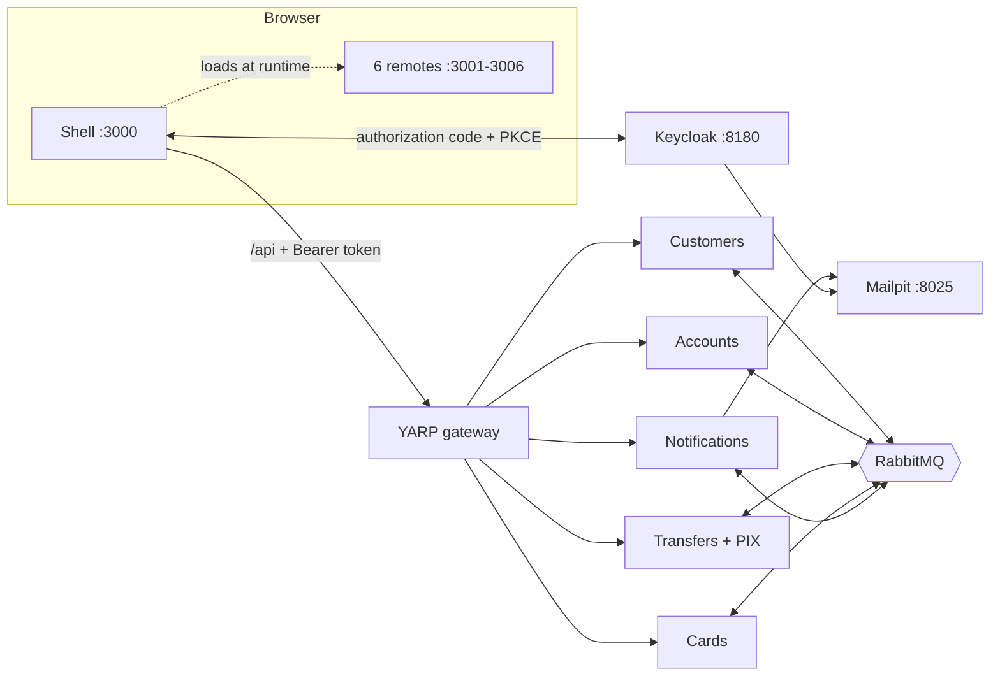
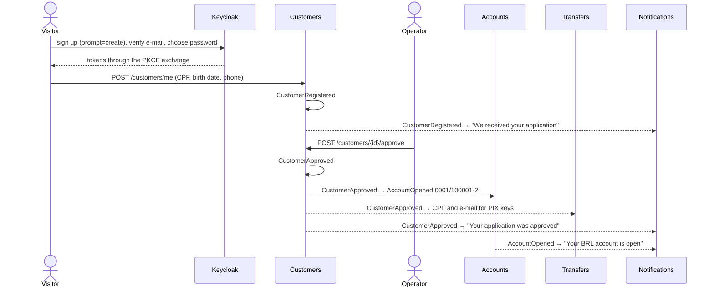

# EventBank

A simulated bank built to show **Domain-Driven Design, CQRS, Event Sourcing, aggregates, sagas and Clean Architecture** in .NET, split into **microservices** that talk through RabbitMQ, **micro-frontends** composed at runtime with Module Federation, and sign-in with **Keycloak using the authorization code flow with PKCE**. Every part lives in its own repository; this one runs them together.

Someone signs up, verifies their e-mail, applies with their CPF, and an operator approves them. The approval opens their checking account; from there they deposit, register PIX keys, send PIX to other customers, and pay with a virtual card. No balance is stored anywhere: every account, transfer, key and card is an append-only stream of events.


## Repositories

| Repository | What it is |
| --- | --- |
| [eventbank-identity](https://github.com/marcelo-roman/eventbank-identity) | Keycloak with the realm: PKCE client, sign-up with e-mail verification, customer and operator roles |
| [eventbank-customers](https://github.com/marcelo-roman/eventbank-customers) | Onboarding: the event-sourced `Customer`, reviewed by operators |
| [eventbank-accounts](https://github.com/marcelo-roman/eventbank-accounts) | Accounts: the event-sourced `BankAccount`, deposits, withdrawals, transfers and card charges |
| [eventbank-transfers](https://github.com/marcelo-roman/eventbank-transfers) | Transfers and PIX: the transfer saga and the `PixKey` aggregate |
| [eventbank-cards](https://github.com/marcelo-roman/eventbank-cards) | Cards: the event-sourced `Card` with its daily limit and purchase saga |
| [eventbank-notifications](https://github.com/marcelo-roman/eventbank-notifications) | E-mails for every step, a deliberately simple context with no event sourcing |
| [eventbank-gateway](https://github.com/marcelo-roman/eventbank-gateway) | YARP gateway, the single HTTP entry point |
| [eventbank-building-blocks](https://github.com/marcelo-roman/eventbank-building-blocks) | NuGet packages: aggregate root, PostgreSQL event store, CQRS, subscriptions, RabbitMQ, JWT validation |
| [eventbank-contracts](https://github.com/marcelo-roman/eventbank-contracts) | NuGet package with the messages the services exchange |
| [eventbank-shell](https://github.com/marcelo-roman/eventbank-shell) | Micro-frontend host: sign-in with PKCE, frame, theme, remotes loaded at runtime |
| [eventbank-mfe-onboarding](https://github.com/marcelo-roman/eventbank-mfe-onboarding) | Application form and its review timeline |
| [eventbank-mfe-accounts](https://github.com/marcelo-roman/eventbank-mfe-accounts) | Accounts, with the read model and the event stream side by side |
| [eventbank-mfe-transfers](https://github.com/marcelo-roman/eventbank-mfe-transfers) | PIX: keys, lookup, sending, and each saga step |
| [eventbank-mfe-cards](https://github.com/marcelo-roman/eventbank-mfe-cards) | Cards: limit, blocking and simulated purchases |
| [eventbank-mfe-backoffice](https://github.com/marcelo-roman/eventbank-mfe-backoffice) | Operator screens: review applications, all customers and accounts |
| [eventbank-mfe-operations](https://github.com/marcelo-roman/eventbank-mfe-operations) | Operator screen: subscription checkpoints and read-model rebuilds |
| eventbank-platform | This repository: Docker Compose for everything, seed data, end-to-end tests |

## What to look at

| Pattern | Where it lives |
| --- | --- |
| Aggregates and invariants | `Customer`, `BankAccount`, `Transfer`, `PixKey` and `Card`: state changes only by raising events; rules throw `DomainException` or record a decline as a fact |
| Value objects | `Cpf` with check digits, `Money`, `Currency`, `AccountNumber` with a modulo-11 digit, `CardNumber` with a Luhn digit, `PixKeyValue` with masking |
| Event sourcing | [`PostgresEventStore`](https://github.com/marcelo-roman/eventbank-building-blocks/blob/main/src/EventBank.BuildingBlocks.EventSourcing/Store/PostgresEventStore.cs) with optimistic concurrency; temporal queries replay an account to any version |
| Uniqueness through streams | A PIX key's stream id is derived from the key, so two people registering it race on version 0 and one wins |
| CQRS | Commands go through aggregates; queries read projections, checkpointed and rebuildable from the first event |
| Sagas | Transfers (debit, credit, refund on decline) and card purchases (reserve the limit, charge, release on decline) |
| Messaging | The event store doubles as the outbox; every consumer is idempotent |
| Clean Architecture | Domain → Application → Infrastructure → Api per service, enforced by architecture tests |
| Security | PKCE in the browser, JWT validation in every service, roles for customer and operator, ownership checks in the application layer |
| Micro-frontends | Remotes found at runtime, shared React singletons, an error boundary per remote, the session handed down as a prop |

## Architecture



Each service has its own PostgreSQL database and validates the token itself; the gateway only routes. No service calls another synchronously: Transfers and Cards keep local copies of the accounts they need, fed by `AccountOpened` and `AccountClosed`.

## Opening an account



## Running

### From published images

```bash
docker compose up -d
./scripts/seed.py
```

### From source

```bash
./scripts/clone-all.sh
./scripts/up-from-source.sh     # needs the .NET 10 SDK for the packages, and Docker
./scripts/seed.py
```

| What | Where |
| --- | --- |
| The bank | <http://localhost:3000> |
| Keycloak | <http://localhost:8180> (admin / admin) |
| E-mails | <http://localhost:8025> |
| RabbitMQ | <http://localhost:15672> (guest / guest) |
| Gateway | <http://localhost:5100/api> |
| PostgreSQL | `localhost:55432` (eventbank / eventbank), one database per service plus `keycloak` |

The seed signs up four people and leaves the bank in a state worth exploring:

| Login | Password | State |
| --- | --- | --- |
| `ana@example.com` | `ana-pass-123` | Approved; deposit, an e-mail PIX key, a PIX sent to Bruno, a card with one approved and one declined purchase |
| `bruno@example.com` | `bruno-pass-123` | Approved; received a PIX, tried to send more than he had |
| `clara@example.com` | `clara-pass-123` | Waiting for review |
| `diego@example.com` | `diego-pass-123` | Rejected, with a reason |
| `operator@eventbank.local` | `operator123` | Operator: back office and projections |

Or sign up yourself with **Open your account**; the verification e-mail arrives in Mailpit.

## End-to-end tests

[Playwright](https://playwright.dev) drives the whole bank through the browser, signing in with the real PKCE flow:

| Spec | What it proves |
| --- | --- |
| `onboarding` | Sign-up with `prompt=create` and S256, e-mail verification through Mailpit, the application, an operator approving it in another browser, the account opening on its own, and the e-mails |
| `backoffice` | A rejection and its reason reaching the customer; customers cannot reach operator screens or other customers' accounts; operators read but cannot move money |
| `accounts` | Deposits, a refused overdraft, a replay, a second account in dollars, and signing out of Keycloak |
| `pix` | Keys, a key already taken, a CPF that is not yours, a masked lookup, a PIX through its saga, both balances and both e-mails |
| `cards` | A captured purchase, a lower limit declining the next one, a blocked card, and the charge in the account statement |
| `platform` | A read-model rebuild, remotes served from their own origins, and the shell surviving one remote going down |

```bash
pnpm install
pnpm exec playwright install chromium
pnpm e2e              # against http://localhost:3000; set EVENTBANK_URL, KEYCLOAK_URL and MAILPIT_URL to point elsewhere
pnpm e2e:report       # a screenshot of every step, a video and a trace for each test
```

## Trade-offs

Choices made to keep the example readable:

- The browser holds the tokens (a public client with PKCE). A backend-for-frontend that keeps them server-side would be the stricter option.
- Messaging uses `RabbitMQ.Client` directly, without a service bus library.
- Commands and queries are dispatched by injecting the handler into the endpoint; there is no mediator.
- Subscriptions poll every 250 ms; `LISTEN/NOTIFY` would cut latency.
- CPF uniqueness at onboarding is checked against a read model, so two simultaneous applications with the same CPF could both pass; PIX keys, by contrast, are unique by construction.
- No snapshots, because streams in this demo are short.

## License

[MIT](LICENSE)
