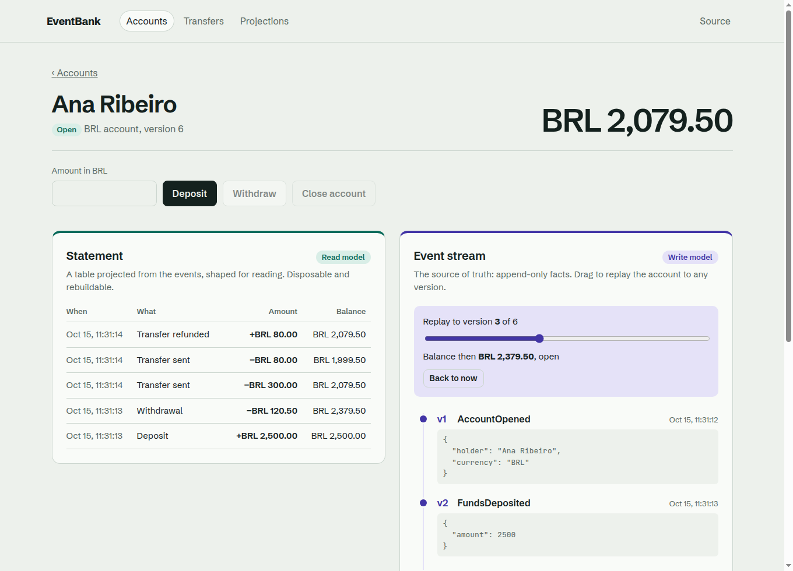
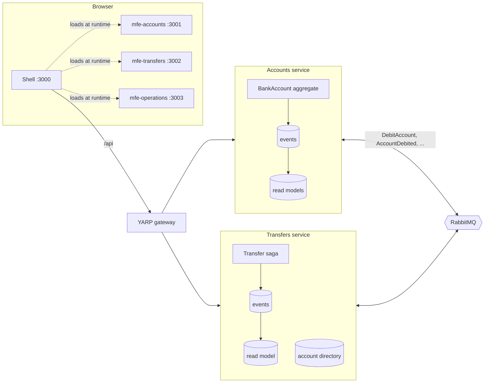
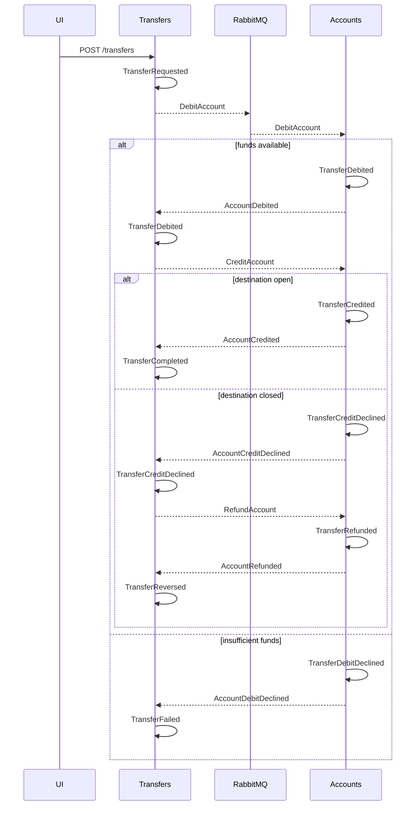

# EventBank

A small bank built to show **Domain-Driven Design, CQRS, Event Sourcing, aggregates and Clean Architecture** in .NET, split into **microservices** that talk through RabbitMQ and **micro-frontends** composed at runtime with Module Federation. Every part lives in its own repository; this one runs them together.

No balance is stored anywhere. Every account is an append-only stream of events, every screen reads a projection of those events, and a transfer between two accounts runs as a saga with compensation.



## Repositories

| Repository | What it is |
| --- | --- |
| [eventbank-accounts](https://github.com/marcelo-roman/eventbank-accounts) | Accounts microservice: the event-sourced `BankAccount` aggregate |
| [eventbank-transfers](https://github.com/marcelo-roman/eventbank-transfers) | Transfers microservice: the event-sourced saga that moves money between accounts |
| [eventbank-gateway](https://github.com/marcelo-roman/eventbank-gateway) | YARP gateway, the single HTTP entry point |
| [eventbank-building-blocks](https://github.com/marcelo-roman/eventbank-building-blocks) | NuGet packages: aggregate root, PostgreSQL event store, CQRS, subscriptions, RabbitMQ |
| [eventbank-contracts](https://github.com/marcelo-roman/eventbank-contracts) | NuGet package with the messages the services exchange |
| [eventbank-shell](https://github.com/marcelo-roman/eventbank-shell) | Micro-frontend host: frame, navigation, theme, runtime loading of remotes |
| [eventbank-mfe-accounts](https://github.com/marcelo-roman/eventbank-mfe-accounts) | Accounts screens, with the read model and the event stream side by side |
| [eventbank-mfe-transfers](https://github.com/marcelo-roman/eventbank-mfe-transfers) | Transfers screens, following each saga step |
| [eventbank-mfe-operations](https://github.com/marcelo-roman/eventbank-mfe-operations) | Subscription checkpoints, lag and read-model rebuilds |
| eventbank-platform | This repository: Docker Compose for everything, database setup, demo data |

## What to look at

| Pattern | Where it lives |
| --- | --- |
| Aggregates and invariants | [`BankAccount`](https://github.com/marcelo-roman/eventbank-accounts/blob/main/src/EventBank.Accounts.Domain/BankAccount.cs) and [`Transfer`](https://github.com/marcelo-roman/eventbank-transfers/blob/main/src/EventBank.Transfers.Domain/Transfer.cs): state changes only by raising events; rules throw `DomainException` |
| Value objects | `Money`, `Currency`, `AccountHolder`, strongly typed ids; each bounded context owns its own `Money` |
| Event sourcing | [`PostgresEventStore`](https://github.com/marcelo-roman/eventbank-building-blocks/blob/main/src/EventBank.BuildingBlocks.EventSourcing/Store/PostgresEventStore.cs) with optimistic concurrency; [`EventSourcedRepository`](https://github.com/marcelo-roman/eventbank-building-blocks/blob/main/src/EventBank.BuildingBlocks.EventSourcing/Store/EventSourcedRepository.cs) folds streams into aggregates |
| Temporal queries | `GET /accounts/{id}/state?version=n` loads an aggregate as it was at any version; the accounts screen drives it with a slider |
| CQRS | Commands go through aggregates and the event store; queries only read projected tables |
| Projections | Checkpointed, committed together with their checkpoint, rebuildable from the first event |
| Read-your-writes | Commands return the new stream version; the UI waits for the read model to reach it |
| Sagas | `Transfer` is an event-sourced process manager that refunds the source when the credit is declined |
| Messaging | The event store doubles as the outbox: a subscription turns stored events into RabbitMQ messages |
| Clean Architecture | Domain → Application → Infrastructure → Api in each service, enforced by architecture tests |
| Micro-frontends | Remotes found at runtime through `config.json`, shared React singletons, an error boundary per remote |

## Architecture



Each service has its own PostgreSQL database. The Transfers service keeps a local directory of accounts, filled from `AccountOpened` and `AccountClosed` messages, so it never calls the Accounts service synchronously.

The services depend on the building blocks and the contracts as versioned NuGet packages, not as source: a change in the chassis reaches a service only when the service upgrades the package.

## The transfer saga



A declined debit is a fact the account records, not an exception. Both aggregates ignore replies they already answered, so redelivered messages are harmless.

## Running

### From published images

```bash
docker compose up -d
./scripts/seed.sh
```

### From source

Clone every repository next to this one, then build the NuGet packages into a local feed and every image from source:

```bash
./scripts/clone-all.sh
./scripts/up-from-source.sh     # needs the .NET 10 SDK for the packages, and Docker
./scripts/seed.sh
```

```text
eventbanking/
├── .feed/                       local NuGet feed written by scripts/local-feed.sh
├── eventbank-platform/
├── eventbank-building-blocks/
├── eventbank-contracts/
├── eventbank-accounts/
└── …
```

| What | Where |
| --- | --- |
| Application | <http://localhost:3000> |
| Gateway | <http://localhost:5100/api/accounts> |
| Remotes | <http://localhost:3001/remoteEntry.js>, `:3002`, `:3003` |
| RabbitMQ console | <http://localhost:15672> (guest / guest) |
| PostgreSQL | `localhost:55432`, databases `accounts` and `transfers` (eventbank / eventbank) |

The seed opens four accounts and sends three transfers: one completes, one fails for lack of funds, and one is reversed because the destination closes while the saga runs.

Stop one remote with `docker compose stop mfe-transfers` to see the shell keep working around it.

## End-to-end tests

[Playwright](https://playwright.dev) drives the whole platform through the browser: opening and funding an account, a domain rule refusing an overdraft, replaying an aggregate to past versions, a transfer that completes, one declined for lack of funds, one refunded after the destination closes mid-saga, a read-model rebuild, and the shell surviving a remote that is down.

```bash
pnpm install
pnpm exec playwright install chromium
pnpm e2e              # against http://localhost:3000; set EVENTBANK_URL to point elsewhere
pnpm e2e:report       # screenshots of every step, a video and a trace for each test
```

## Trade-offs

Choices made to keep the example small and readable:

- Messaging uses `RabbitMQ.Client` directly instead of a service bus library, so the topology is visible in a few files.
- Commands and queries are dispatched by injecting the handler into the endpoint; there is no mediator.
- Subscriptions poll every 250 ms; `LISTEN/NOTIFY` would cut latency further.
- No snapshots, because streams in this demo are short.
- Each micro-frontend repeats the few helpers it needs (API client, formatting) instead of sharing a package.
- No authentication.

## License

[MIT](LICENSE)
